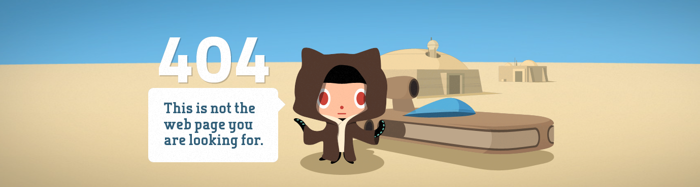

---

<!--START_SECTION:waka-->


**🐱 我的 GitHub 数据** 

> 📦  使用了 99.5 kB GitHub 存储空间 
 > 
> 🏆 644 个贡献，在 2026 年
 > 
> 💼 开放招聘
 > 
> 📜 26 个公共仓库 
 > 
> 🔑 6 个私人仓库 
 > 
**我是早鸟 🐤** 

```text
🌞 早晨                     401 commits         █████░░░░░░░░░░░░░░░░░░░░   19.21 % 
🌆 白天                     704 commits         ████████░░░░░░░░░░░░░░░░░   33.73 % 
🌃 傍晚                     713 commits         █████████░░░░░░░░░░░░░░░░   34.16 % 
🌙 晚上                     269 commits         ███░░░░░░░░░░░░░░░░░░░░░░   12.89 % 
```
📅 **星期二 时的我最有干劲** 

```text
星期一                      258 commits         ███░░░░░░░░░░░░░░░░░░░░░░   12.36 % 
星期二                      406 commits         █████░░░░░░░░░░░░░░░░░░░░   19.45 % 
星期三                      181 commits         ██░░░░░░░░░░░░░░░░░░░░░░░   08.67 % 
星期四                      399 commits         █████░░░░░░░░░░░░░░░░░░░░   19.12 % 
星期五                      299 commits         ████░░░░░░░░░░░░░░░░░░░░░   14.33 % 
星期六                      217 commits         ███░░░░░░░░░░░░░░░░░░░░░░   10.40 % 
星期日                      327 commits         ████░░░░░░░░░░░░░░░░░░░░░   15.67 % 
```


📊 **本周消耗时间** 

```text
🕑︎ 时区: Asia/Shanghai

💬 编程语言: 
TypeScript               3 hrs 45 mins       ███████░░░░░░░░░░░░░░░░░░   29.94 % 
JavaScript               2 hrs 26 mins       █████░░░░░░░░░░░░░░░░░░░░   19.45 % 
YAML                     2 hrs 4 mins        ████░░░░░░░░░░░░░░░░░░░░░   16.58 % 
JSON                     1 hr 46 mins        ████░░░░░░░░░░░░░░░░░░░░░   14.19 % 
PowerShell               57 mins             ██░░░░░░░░░░░░░░░░░░░░░░░   07.68 % 

🔥 编辑器: 
VS Code                  12 hrs 31 mins      █████████████████████████   100.00 % 

🐱‍💻 项目: 
MoeKoeMusic              5 hrs 9 mins        ██████████░░░░░░░░░░░░░░░   41.18 % 
Authenticator            2 hrs 51 mins       ██████░░░░░░░░░░░░░░░░░░░   22.81 % 
mc-tools                 2 hrs 31 mins       █████░░░░░░░░░░░░░░░░░░░░   20.11 % 
FxxkWeChatAppEx          1 hr 45 mins        ████░░░░░░░░░░░░░░░░░░░░░   14.07 % 
avatar                   5 mins              ░░░░░░░░░░░░░░░░░░░░░░░░░   00.74 % 

💻 操作系统: 
Windows                  12 hrs 31 mins      █████████████████████████   100.00 % 
```

🤖 **AI Coding This Week** 

```text
No AI Coding Activity Tracked This Week
```

**我最常使用 TypeScript** 

```text
TypeScript               28 repos            █████████░░░░░░░░░░░░░░░░   37.84 % 
JavaScript               16 repos            █████░░░░░░░░░░░░░░░░░░░░   21.62 % 
Vue                      14 repos            █████░░░░░░░░░░░░░░░░░░░░   18.92 % 
HTML                     6 repos             ██░░░░░░░░░░░░░░░░░░░░░░░   08.11 % 
NSIS                     1 repo              ░░░░░░░░░░░░░░░░░░░░░░░░░   01.35 % 
```


 Last Updated on 30/10/2026 03:16:24 UTC
<!--END_SECTION:waka-->
